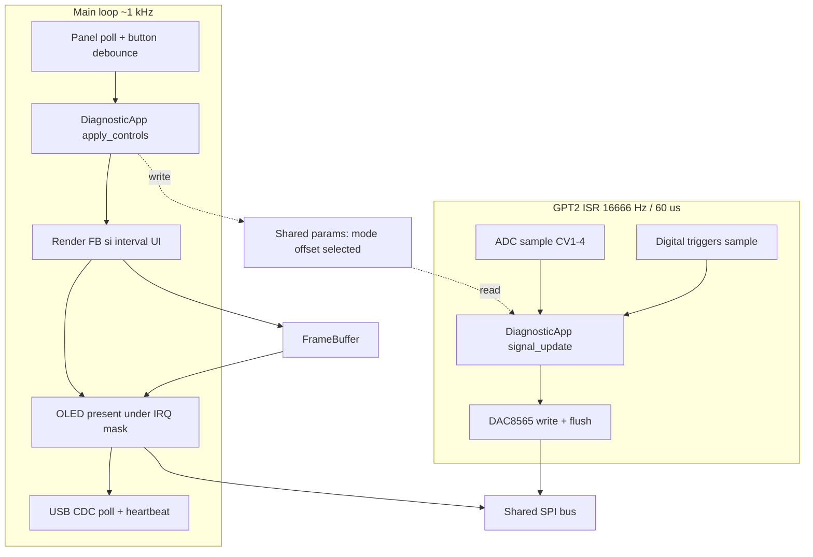

> **État (2026-11-16)** : option **A** de [D-023](../../journal/D-023-dual-rate-signal-isr.md), **proposée, non
> adoptée**. Rédigé par l'assistant Junie le 2026-08-02 et resté hors git (`.git/info/exclude`) jusqu'au lot 3a ;
> déplacé ici depuis `.junie/plans/isr-16khz-dual-rate.md`, texte d'origine inchangé ci-dessous.
>
> À lire avec ces corrections, postérieures au plan :
>
> * **OLED sous masque d'IRQ (Key Decision 5) : contredit par l'étude** `docs/supersaw/` § 12–13, qui juge
>   inacceptable de manquer ≈ 16 échéances par trame pour tout chemin audio. Voir D-023 § « Points ouverts » : le
>   découpage de la trame par pages entre deux périodes est la condition pour que A prépare B au lieu de la bloquer.
> * **Anti-rebond des triggers** (table « Budget chiffré », risque « 180 µs ») : caduc, les triggers n'ont plus de
>   filtre temporel depuis la révision de D-019 (lot 3a).
> * **`patched`** dans `signal_update` (§ Proposed Changes 1) : caduc, la présence de câble a été retirée (D-019,
>   lot 3a).
> * **Mesure « travail ≈ 20 µs »** : rapportée d'un journal USB non conservé ; à refaire au lot 3b avant tout
>   chiffrage.

# Requirements

### Overview & Goals

Passer le firmware d’une **boucle coopérative unique à 1 kHz** à l’architecture de référence O&C / Phazerville :

- **chemin signal** en ISR GPT @ **16 666 Hz** (période **60 µs**) : ADC → process → DAC ;
- **chemin UI** en boucle basse priorité (~**1 kHz**) : encodeurs, boutons, splash/diagnostic render, USB CDC ;
- chiffrage explicite des constantes (`TICK` / `RENDER` / debounce / heartbeat) et de l’impact **OLED/SPI** partagé.

Objectif mesurable après flash : log USB montrant un rythme ISR stable (~60 µs), `oled init ok`, écran diagnostic lisible, durée de travail ISR nettement sous 60 µs hors contention SPI.

### Scope

#### In Scope

- Découpage comportemental dans `oc-core` : `signal_tick` vs `ui_tick` (avec `tick()` conservé pour sim / VCV / tests).
- ISR réelle sur **GPT2** @ 16 666 Hz dans `oc-firmware` (GPT1 reste l’horloge libre-running µs).
- Boucle main : UI + OLED + USB poll.
- Arbitrage SPI DAC/OLED compatible bi-contexte (ISR + main).
- Constantes, docs (`TESTING.md` §9.x, `AGENTS.md`, commentaires `board.rs` / `debounce.rs`).
- Compteurs de diagnostic : overruns ISR, durée ISR, heartbeat USB.

#### Out of Scope

- Vrai audio 48 kHz / DMA audio.
- DMA SPI OLED façon Phazerville `display::Flush/Update` (noté comme suite ; v1 = present depuis la boucle UI avec arbitration).
- RTIC complet (pas nécessaire pour la v1 ; réévaluable plus tard).
- Changement du taux VCV Rack (~1 kHz décimé) ni des scénarios sim au-delà de l’API `Engine::tick` stable.
- Nouveaux applets musicaux.

### User Stories

- En tant que développeur module, je veux un **control rate O&C (16 666 Hz)** sur les jacks pour que CV/gates aient une granularité ~60 µs.
- En tant que débogueur hardware, je veux voir sur USB le **rythme ISR**, les **overruns** et la **durée** pour valider le budget 60 µs.
- En tant qu’utilisateur panneau, je veux que l’**OLED et les encodeurs** restent fluides sans faire rater le chemin signal de façon catastrophique.

### Functional Requirements

1. **Signal ISR @ 60 µs** : échantillonner CV + triggers, mettre à jour la logique signal du diagnostic, écrire/flusher le DAC.
2. **UI loop ~1 kHz** : poll panel (encodeurs/boutons), debounce mécanique ~3 ms, render OLED ~50 Hz, poll USB CDC, heartbeat.
3. **`Engine::tick`** reste l’API unique sim/VCV = `signal_tick` puis `ui_tick` (comportement host inchangé au premier ordre).
4. **Splash** piloté en temps (µs), rendu uniquement sur le chemin UI — plus de `present()` à chaque tick signal.
5. Log de boot adapté : `entering signal ISR @16666 Hz` + `ui loop` ; heartbeat avec `isr_us=… overdue=…`.

### Non-Functional Requirements

- Budget ISR **60 µs** ; travail signal actuel ~**20 µs** → marge ~2/3 hors OLED.
- `oc-core` / `oc-drivers` restent `forbid(unsafe_code)` ; `oc-firmware` garde `deny(unsafe_code)` si l’accès partagé passe par `cortex-m::interrupt::Mutex` (sinon `unsafe` documenté `# Safety`).
- Pas de panique dans l’ISR (pas de `RefCell` borrow cross-context non protégé).
- Calibration / pinout inchangés (`board.rs` reste le seul fichier à nommer des pins).

# Technical Design

### Current Implementation

 Élément | Aujourd’hui | Fichier |
---------|-------------|--------|
 Période boucle | `TICK_PERIOD_MICROS = 1_000` (1 kHz) | `crates/oc-firmware/src/board.rs` |
 Render | `RENDER_INTERVAL_TICKS = 20` → ~50 Hz | idem |
 Boucle | coopérative : sample → `Engine::tick` → busy-wait deadline | `crates/oc-firmware/src/main.rs` |
 Engine | un seul `tick()` : acquire + update + DAC + render optionnel | `crates/oc-core/src/engine.rs` |
 Debounce | `DEFAULT_STABLE_SAMPLES = 3` → **3 ms @ 1 kHz** | `crates/oc-core/src/debounce.rs` |
 Horloge | GPT1 @ 1 MHz, `Cell`, **doc : pas d’usage depuis une IRQ** | `crates/oc-firmware/src/clock.rs` |
 GPT2 | exposé par le BSP, **inutilisé** | `teensy4-bsp` `Resources.gpt2` |
 SPI partagé | `RefCell` + `SharedBus`, hypothèse single-thread coopératif | `crates/oc-drivers/src/shared_bus.rs` |
 USB CDC | poll dans la boucle, IRQ USB off | `main.rs` + `imxrt-log` |
 Référence O&C | `CORE_timer_ISR` @ 60 µs + `UI_timer_ISR` @ 1 ms | Phazerville `Main.cpp` / `OC_config.h` |

Mesure terrain (log USB antérieur) : `duration_micros ≈ 20 µs` à l’écran, période nominale 1 ms.

### Budget chiffré (16 666 Hz)

```text
Budget ISR          = 1e6 / 16666 ≈ 60.00 µs
Travail signal actuel ≈ 20 µs          → ~33 % du budget
DAC SPI 4×24 bit @ 8 MHz ≈ 12 µs purs (+ overhead CS/flush)
OLED frame SH1106   ≈ 8×(3+128) o     → ~1048 µs purs @ 8 MHz  ★ hors ISR
OLED 1 page         ≈ 131 o           → ~131 µs                ★ > 60 µs
```

 Constante | 1 kHz (actuel) | Cible dual-rate |
-----------|----------------|-----------------|
 `SIGNAL_RATE_HZ` | (implicite 1000) | **16_666** |
 `SIGNAL_PERIOD_MICROS` | 1000 | **60** |
 Chemin UI | = signal | **~1_000 µs** (boucle main) |
 `RENDER_INTERVAL` | 20 ticks signal (~50 Hz) | **20 ticks UI** (~50 Hz) si UI @ 1 kHz |
 Debounce boutons | 3 samples × 1 ms = 3 ms | **3 samples × 1 ms UI = 3 ms** (inchangé en temps) |
 Debounce/edge triggers | 3 samples × 1 ms = 3 ms | **3 samples × 60 µs ≈ 180 µs** (plus réactif, OK gates) |
 `HEARTBEAT` | 1000 ticks | **1000 ticks UI** ou 16666 ISR → 1 Hz |
 Splash 1,5 s | render chaque tick signal | render **UI seulement**, avance basée µs |

**Impact OLED/SPI (décision retenue : résoudre dans le dual-rate, pas en jitter coopératif naïf)**

- L’OLED **ne peut pas** vivre dans l’ISR sans DMA : 1 page > 60 µs, 1 frame ~1 ms.
- V1 : **ISR = owner prioritaire du DAC** ; **main = present OLED** sous section critique qui **masque l’IRQ GPT2** le temps de la transaction SPI (frame ou plus tard pages).
- Coût : pendant ~1 ms de `present()`, ~**16** deadlines ISR manquées → compteur `overdue` / `masked_us` exposé en log. Acceptable pour diagnostic CV ; **pas** pour audio sample-accurate (DMA plus tard).
- `SharedBus` basé `RefCell` seul est **insuffisant** dès qu’ISR et main coexistent → remplacer le partage firmware par un bus protégé IRQ (`critical_section` / mask GPT2), en gardant l’API drivers `SpiBus`.

### Key Decisions

1. **Fréquence** : **16 666 Hz exact** (`PERIOD = 60` µs), aligné `OC_CORE_ISR_FREQ` Phazerville — pas 16 000 « rond ».
2. **Timer ISR** : **GPT2** en mode periodic output-compare ; **GPT1** reste l’horloge monotone `SystemClock` (lecture surtout UI ; l’ISR utilise `elapsed = 60` nominal ou un compteur de ticks ISR).
3. **Pas de RTIC en v1** : handler `imxrt-rt`/`cortex-m-rt` + `cortex-m::interrupt::Mutex` pour l’état partagé ; reste cohérent avec USB polled sans RTIC. RTIC = option ultérieure si la composition grossit.
4. **Split `oc-core`** plutôt que tout dupliquer dans le firmware : la frontière signal/UI est testée une fois sur hôte.
5. **OLED** : present depuis UI avec mask IRQ ; pas de DMA SPI dans ce plan ; documenter la suite Phazerville (page/DMA interleaved dans l’ISR).
6. **Sim / VCV** : continuent d’appeler `Engine::tick` @ ~1 kHz ; pas d’émulation ISR obligatoire.

### Architecture



Comparaison Phazerville :

```text
Phazerville CORE ISR: Flush OLED DMA → DAC → start OLED DMA → ADC → Dig → app
Phazerville UI ISR:   ui.Poll @ 1 kHz
Alambic v1:           GPT2 ISR = ADC+Dig+app_signal+DAC
                      main     = ui.Poll + render + OLED SPI masked + USB
```

### Proposed Changes

#### 1. `oc-core` — dual tick API

Fichier principal : `crates/oc-core/src/engine.rs` (+ `app.rs` si split des méthodes).

- Extraire de `DiagnosticApp::update` :
  - `signal_update(&mut self, cv, triggers, patched, elapsed_micros) -> outputs` (detectors, edge triggers, ramp, `compute_outputs`) ;
  - `apply_controls` reste appelé depuis le chemin UI seulement.
- `Engine` :
  - `signal_tick(&mut self) -> SignalReport` : acquire CV/TR (pas controls), `signal_update`, write/flush DAC, **pas** de render ;
  - `ui_tick(&mut self) -> UiReport` : `controls.poll`, `apply_controls`, render si `render_interval` UI atteint, splash advance/render ;
  - `tick()` = `signal_tick` + `ui_tick` pour sim/VCV/tests (elapsed controls partagés comme aujourd’hui).
- Splash : uniquement dans `ui_tick` / `tick_splash` ; pendant le splash, `signal_tick` maintient les sorties à 0 (ou `tick()` garde le gating actuel).
- `set_render_interval` interprété en **ticks UI** une fois le firmware dual-rate (sim : toujours 1 par défaut).

Tests hôte : non-régression `tick()` ; tests unitaires que les boutons ne changent le mode **que** via `ui_tick` ; que le ramp avance sur `signal_tick` avec `elapsed=60`.

#### 2. Constantes firmware

`crates/oc-firmware/src/board.rs` :

```rust
pub(crate) const SIGNAL_RATE_HZ: u32 = 16_666;
pub(crate) const SIGNAL_PERIOD_MICROS: u32 = 60; // 1e6 / 16666
pub(crate) const UI_PERIOD_MICROS: u32 = 1_000;
pub(crate) const RENDER_INTERVAL_UI_TICKS: u32 = 20; // ~50 Hz
// retirer ou alias déprécié TICK_PERIOD_MICROS / RENDER_INTERVAL_TICKS
```

`main.rs` : `HEARTBEAT_UI_TICKS = 1_000` ; messages log mis à jour.

#### 3. `oc-firmware` — ISR + main

- Configurer **GPT2** : clock source alignée BSP, divider pour counts commodes, OCR @ période 60 µs, IRQ enable.
- État partagé dans `Mutex`/`RefCell` (ou structure découpée) : handles ADC, triggers, DAC, fragment app signal ou double buffer des **params UI** (`mode`, `offset_mv`, `selected`) écrits par main, lus par ISR.
- Pattern params lock-free simple : `AtomicI32` / `AtomicU8` pour offset/mode/selected (millivolts et enums bornés) afin d’éviter de partager tout `DiagnosticApp` entre contextes si trop lourd ; **alternative acceptable** : un seul `Mutex` autour de l’app si les sections restent courtes.
- ISR : clear flag GPT → signal path → mesure cycles/µs → si réentrée/overdue, `fetch_add` compteur.
- Main : pace ~1 kHz sur GPT1 clock → `ui_tick` path + `usb_log.poll()`.
- **SPI** : wrapper firmware qui masque GPT2 IRQ pendant `SpiBus` ops du présent OLED ; l’ISR DAC suppose bus libre ou vérifie un flag `spi_busy` et incrémente `dac_skipped` si occupé (ne jamais `RefCell::borrow` paniquant).
- Mettre à jour le module doc de `shared_bus.rs` : l’hypothèse coopérative pure ne tient plus côté firmware ; le driver reste dumb `SpiBus`, l’arbitration est au-dessus.

#### 4. Horloge

- `SystemClock` : documenter + garantir usage **hors ISR** (UI only), ou passer les `Cell` derrière `Mutex` si l’ISR doit logger `now_micros`.
- Préférer : ISR n’appelle pas `now_micros` ; utilise période nominale 60 µs et un `AtomicU32` `isr_count`.

#### 5. Docs

- `TESTING.md` §9.1 : nouvelle séquence attendue (plus de « 1 kHz loop ») ; critères overrun ; comment lire `isr_us` / `overdue`.
- `AGENTS.md` : boucle 1 kHz → dual-rate ISR 16 666 + UI 1 kHz ; index fichiers si nouveau module `isr.rs` / `signal_runtime.rs`.
- Commentaires `debounce.rs` : préciser **échantillons UI** vs **échantillons signal** pour les triggers.

### File Structure

 Fichier | Action |
---------|--------|
 `crates/oc-core/src/engine.rs` | Split `signal_tick` / `ui_tick` ; `tick` compose |
 `crates/oc-core/src/app.rs` | Split update signal vs controls |
 `crates/oc-core/src/debounce.rs` | Doc temps de latence selon le chemin |
 `crates/oc-firmware/src/board.rs` | Constantes 16666 / 60 / UI / render |
 `crates/oc-firmware/src/main.rs` | Init GPT2, spawn logique dual-rate |
 `crates/oc-firmware/src/clock.rs` | Contrat hors-ISR clarifié |
 `crates/oc-firmware/src/isr.rs` (nouveau, optionnel) | Handler GPT2 + shared state |
 `crates/oc-firmware/src/spi_arm.rs` (nouveau, optionnel) | Mask IRQ autour des xfers OLED |
 `crates/oc-drivers/src/shared_bus.rs` | Doc multi-contexte ; API inchangée si possible |
 `TESTING.md`, `AGENTS.md`, `README.md` | Rythme, validation, index |
 `crates/oc-sim` / `oc-vcv-ffi` | Aucun changement API attendu si `tick()` stable |

### Risks

 Risque | Mitigation |
--------|------------|
 Panic `RefCell` cross ISR/main | Pas de `RefCell` partagé non masqué ; flag `spi_busy` + mask IRQ |
 Overrun ISR si process grossit | Compteur `overdue` + log ; budget headroom 40 µs aujourd’hui |
 ~16 samples DAC manqués pendant OLED | Accepté v1 CV ; log `dac_skipped` ; suite = DMA pages |
 `deny(unsafe_code)` vs vecteur d’IRQ | Préférer APIs safe BSP/`cortex-m` ; sinon `unsafe` minimal + `# Safety` |
 Debounce triggers trop court (180 µs) | Garder 3 samples ; rendre `required` configurable si rebond hardware |
 Complexité état app partagé | Atomics pour params UI → signal ; état lourd reste partitionné |
 Splash jadis render every signal tick | Forcer render UI-only (sinon SPI 16 k×/s = mort) |

# Testing

### Validation Approach

1. **Hôte** : `cargo test -p oc-core` (split signal/ui + `tick()` compose) ; `cargo test -p oc-drivers` ; clippy host + firmware target.
2. **Build** : `cargo xtask build|size|hex` — layout mémoire toujours vert.
3. **Hardware** (Level 9 étendu) : flash + USB CDC 115200.

### Key Scenarios

 Scénario | Attendu |
----------|---------|
 Boot log | `oled=SH1106`, `oled init ok`, entrée ISR 16666 Hz, UI loop |
 Heartbeat | ~1 Hz ; `isr_us` typ. ≪ 60 ; `overdue` ~0 hors frames OLED |
 Pendant OLED on | `overdue` ou `dac_skipped` peut monter par salves ~50/s ; pas de SOS |
 Écran | splash ~1,5 s puis diagnostic lisible ; bannière durée = travail UI ou ISR selon ce qu’on affiche (à figer : **durée ISR** plus utile) |
 Encodeurs / boutons | mode offset/ramp/zero, sélection canal, toujours ~3 ms debounce perçu |
 CV/tr path | ramp plus lisse qu’à 1 kHz ; triggers comptent aux fronts rapides |

### Edge Cases

- Splash + USB enumeration : pas d’ISR panic, sorties à 0 pendant splash.
- Host USB absent : ISR continue (pas de dépendance log).
- Long `present()` OLED : pas de deadlock SPI ; ISR reprend après unmask.
- Wrap GPT1 clock sur UI path toujours correct.

### Test Changes

- `oc-core` : tests `signal_tick_does_not_apply_buttons`, `ui_tick_changes_mode`, `tick_still_matches_composed_paths`, ramp avec `elapsed=60`.
- Pas de unit tests dans `oc-firmware` (convention repo) — validation hardware + logs.
- Scénarios `oc-sim` : régénérer screens **seulement** si le découpage change un frame (idéalement non).

# Delivery Steps

###   Step 1: Split Engine signal/ui in oc-core
oc-core exposes signal_tick and ui_tick; tick() still composes both for sim/VCV.

- Refactor `DiagnosticApp::update` into signal path (CV/triggers/ramp/outputs) vs `apply_controls` on UI path in `app.rs`.
- Add `Engine::signal_tick` / `Engine::ui_tick` in `engine.rs`; keep `tick()` as sequential composition so `oc-sim` / `oc-vcv-ffi` stay API-stable.
- Ensure splash gating keeps outputs at rest and renders only on the UI/splash path (never at signal rate).
- Document debounce timing: buttons measured in UI samples; trigger edge counters in signal samples.
- Add host unit tests for the split and non-regression of combined `tick()`.
- Run `cargo test -p oc-core` and clippy on host crates.

###   Step 2: Firmware constants and GPT2 signal ISR
Firmware runs Diagnostic signal+DAC from a GPT2 ISR at 16_666 Hz (60 µs).

- Replace `TICK_PERIOD_MICROS` / `RENDER_INTERVAL_TICKS` in `board.rs` with `SIGNAL_RATE_HZ=16_666`, `SIGNAL_PERIOD_MICROS=60`, `UI_PERIOD_MICROS=1_000`, `RENDER_INTERVAL_UI_TICKS=20`.
- Configure unused BSP `gpt2` as periodic 60 µs IRQ; keep `gpt1` as free-running `SystemClock` for the UI loop only.
- Introduce shared ISR state (params + peripheral handles) via `cortex-m` critical sections / atomics; implement the GPT2 handler calling the signal path only (ADC, triggers, app signal update, DAC flush).
- Add overrun / `isr_duration` / optional `dac_skipped` counters for USB diagnosis.
- Clarify `clock.rs` contract: not read from the ISR (nominal 60 µs elapsed in signal path).

###   Step 3: UI loop, SPI arbitration, OLED present under IRQ mask
Main loop owns UI ~1 kHz, USB, and OLED; SPI no longer assumes single-thread coop only.

- Rework `main.rs` loop: pace UI on `UI_PERIOD_MICROS`, run controls/debounce/render/splash, `usb_log.poll()`, 1 Hz heartbeat with ISR stats.
- Implement SPI arbitration so OLED `present()` masks GPT2 (or sets `spi_busy`) for the transfer duration; DAC ISR never panics on `RefCell`.
- Update `shared_bus.rs` docs for dual-context firmware usage; keep driver API `SpiBus` unless a thin firmware wrapper is cleaner.
- Wire `set_render_interval(RENDER_INTERVAL_UI_TICKS)` on the UI path (~50 Hz).
- Build release HEX via `cargo xtask hex`; clippy firmware target.

###   Step 4: Docs and hardware validation checklist
Docs match dual-rate reality; Level 9 spells out how to read ISR health on USB.

- Update `TESTING.md` §9.1 (boot lines, heartbeat fields, overdue during OLED, pass criteria).
- Update `AGENTS.md` / `README.md`: 1 kHz loop → ISR 16_666 + UI 1 kHz; pin GPT1/GPT2 roles; known OLED mask jitter (~1 ms / ~16 signal ticks per frame).
- Flash and verify on module: stable ISR log, readable SH1106 UI, encoders/buttons, no SOS; record typical `isr_us` and overdue behavior during redraws.
- Note follow-ups explicitly out of this delivery: SPI DMA page interleave (Phazerville), 48 kHz audio path.